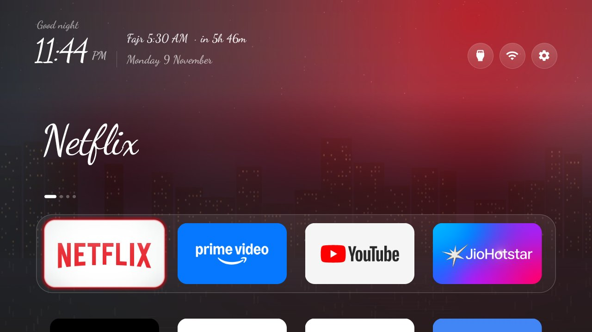
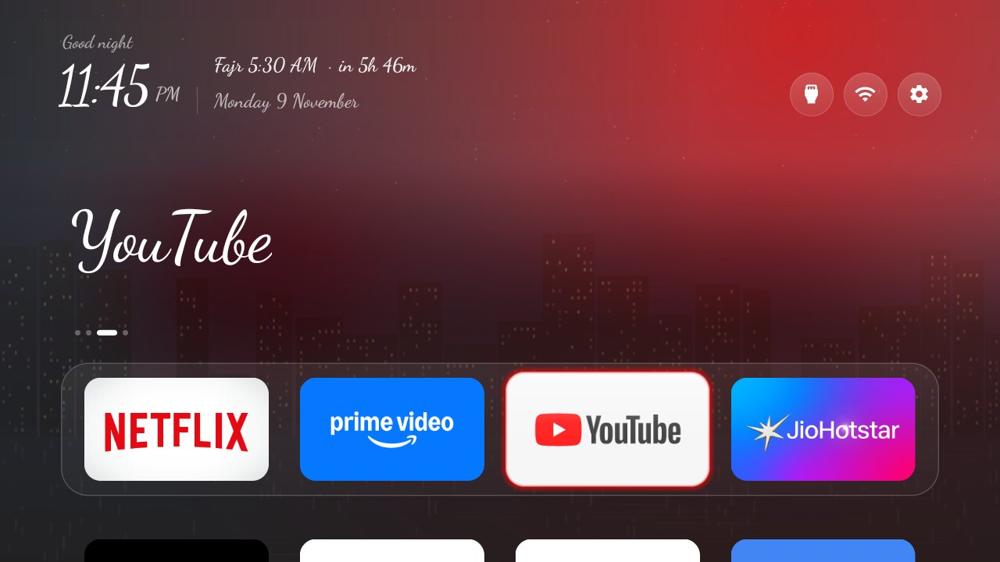
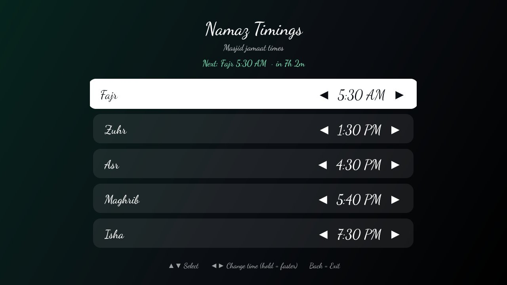
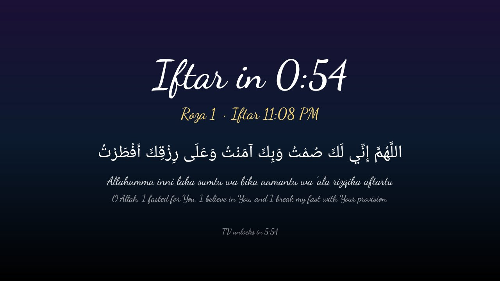

# Android to Apple: Android TV ko Apple TV jaisa banayein (Windows guide)

Yeh guide ek purane Android TV ko **Apple TV jaisa saaf Home screen**, **family photo screensaver**,
**Namaz Timings + alert** aur **Ramadan mode** ke saath set karne ke liye hai. Sab kuch Windows PC se,
Wi-Fi par, bina root ke hota hai.

> **Tested on:** Realme "AI PONT" Smart TV (Changhong), **Android TV 9** (SDK 28), Windows 10 PC.
> Doosre TV par bhi chalna chahiye (Android 8 ya upar), lekin har TV alag hota hai. Pehle **backup** lijiye
> aur **restore ke steps** (section 12) save kar lijiye. Apne TV ki zimmedari aapki hai.

Yeh project [Gathin23/cleanyourtv](https://github.com/Gathin23/cleanyourtv) (MIT license) aur
[anuanurag2410/cleanyourtv](https://github.com/anuanurag2410/cleanyourtv) ka fork hai. Launcher unka hai;
is fork mein neeche wale features jode gaye hain.

| Home (Netflix par focus) | Home (YouTube par focus) |
|---|---|
|  |  |
| **Namaz Timings (remote se set)** | **Iftar countdown + dua (Ramadan)** |
|  |  |

---

## Kya milega

- **Apple TV jaisa Home:** cinematic top shelf, kaanch jaisa dock, har ghante badalta wallpaper, app ke rang ki glow, gol buttons.
- **Curly font** (Dancing Script) poore launcher mein.
- **Family Photos screensaver:** pen drive ya TV ke `TVPhotos` folder ki photos, badi ghadi, date aur agli namaz ke saath. Ghadi apne aap photo ke khaali kone mein jaati hai.
- **Namaz Timings tile:** masjid ki jamaat ka time remote se set karein (Fajr, Zuhr, Asr, Maghrib, Isha, Jumu'ah).
- **Home aur screensaver par agli namaz:** `Asr 4:30 PM · in 35m`, aur jamaat ke 15 min tak `· now`.
- **Namaz alert:** jamaat se 5 min pehle 3 baar chime aur **15 min ke liye full-screen lock** ("Asr Namaz Time · Please go to pray"). Is dauraan YouTube ya koi app nahi khulta. TV standby mein ho to kuch nahi bajta.
- **Ramadan mode:** Sehri/Iftar countdown, Iftar se 10 min pehle lock, dua, Iftar par chime, aur Ramadan mein Maghrib ka lock band.
- **Glass Quick Settings panel:** ⚙️ dabane par Namaz Timings, **Brightness ◀ ▶** (TV backlight, MediaTek TVs par), Network, Apps aur TV settings.
  Brightness ke liye `WRITE_SECURE_SETTINGS` permission chahiye (section 6). Jin TVs mein `picture_backlight` setting nahi hoti, wahan yeh row nahi dikhti.
  Backlight **0 ke baad bhi ◀** dabane par **Dim 10% → 80%** aata hai: poori screen (video bhi) par ek gehri parat. Iske liye
  `SYSTEM_ALERT_WINDOW` (appops, section 6) chahiye. ▶ se dim pehle hatta hai, phir backlight badhti hai. TV restart ke baad bhi dim bana rehta hai.

---

## 1. Kya chahiye

- Android TV / Google TV (Android 8 ya upar), uska remote.
- Windows 10/11 PC, aur **TV aur PC ek hi Wi-Fi par**.
- Internet (tools download karne ke liye), lagbhag 3 GB jagah.

## 2. TV par Developer options aur USB debugging

1. TV: **Settings → Device Preferences → About**.
2. **Build** par OK **7 baar** dabaiye, jab tak "You are now a developer" na aa jaaye.
3. Wapas jaakar **Developer options → USB debugging ON** kijiye.
4. **Settings → Network & Internet** mein TV ka **IP address** note kijiye (jaise `192.168.1.50`).

> Kuch TVs mein restart ke baad Wi-Fi debugging band ho jaati hai. Connect na ho to USB debugging OFF → ON kijiye.

## 3. PC par tools install karein

**PowerShell** kholiye aur ek-ek karke chalaiye:

```powershell
winget install --id Git.Git -e
winget install --id EclipseAdoptium.Temurin.17.JDK -e
winget install --id Google.PlatformTools -e
winget install --id Python.Python.3.12 -e
```

Android SDK ke liye **Android Studio** install kijiye (`winget install --id Google.AndroidStudio -e`), ek baar kholiye,
aur SDK Manager se **Android 14 (API 34) SDK Platform** aur **Build-Tools 34** install kijiye.
SDK aam taur par `C:\Users\<aapka naam>\AppData\Local\Android\Sdk` mein hota hai.

Naya PowerShell kholkar check kijiye:

```powershell
adb version
java -version
```

## 4. Code download aur build

> **Chhota folder use karein.** Lambe path par Git "Filename too long" error deta hai.

```powershell
mkdir C:\tv
cd C:\tv
git clone https://github.com/imteyazzzz/android-to-apple.git
cd android-to-apple\launcher
```

SDK ka path `local.properties` mein likhiye. **Forward slash (/) use karein**, warna build "volume label syntax" error deta hai:

```powershell
Set-Content local.properties "sdk.dir=C:/Users/<aapka naam>/AppData/Local/Android/Sdk"
.\gradlew.bat assembleRelease
```

`BUILD SUCCESSFUL` aana chahiye. APK yahan banega: `launcher\app\build\outputs\apk\release\app-release.apk`

> "process cannot access the file" error aaye to `.\gradlew.bat --stop` chalaiye aur dobara build kijiye.

## 5. TV se connect aur backup

```powershell
adb connect <TV-IP>:5555
adb devices
```

TV par **"Allow USB debugging?"** aayega. **Always allow** tick karke **Allow** dabaiye. `device` likha aana chahiye.

Backup (PC ke Desktop par):

```powershell
$B = "$env:USERPROFILE\Desktop\TV-Backup"; mkdir $B
adb shell pm list packages > "$B\packages-all.txt"
adb shell pm list packages -d > "$B\packages-disabled-before.txt"
adb shell settings list secure > "$B\settings-secure.txt"
adb shell cmd package resolve-activity --brief -a android.intent.action.MAIN -c android.intent.category.HOME > "$B\home-before.txt"
```

`home-before.txt` mein aapke TV ka **purana launcher** likha hoga (aksar `com.google.android.tvlauncher/.MainActivity`). Ise yaad rakhiye.

## 6. Launcher install aur test

```powershell
adb push app\build\outputs\apk\release\app-release.apk /data/local/tmp/tv.apk
adb shell pm install -r /data/local/tmp/tv.apk
adb shell pm grant com.gathin.tvhome android.permission.READ_EXTERNAL_STORAGE
adb shell pm grant com.gathin.tvhome android.permission.WRITE_SECURE_SETTINGS
adb shell appops set com.gathin.tvhome SYSTEM_ALERT_WINDOW allow
adb shell am start -n com.gathin.tvhome/.MainActivity
```

Remote se check kijiye: apps khulte hain, awaaz aati hai, Inputs/HDMI chalte hain.
**Abhi Home button purana launcher kholega, yeh normal hai.**

## 7. Default Home banayein

Pehle bina kuch band kiye koshish kijiye:

```powershell
adb shell cmd package set-home-activity --user 0 com.gathin.tvhome/.MainActivity
```

Home dabaiye. Naya launcher khule to bas. Agar purana hi khulta hai, to **sirf wahi package** band kijiye jo
`home-before.txt` mein tha. Yeh uninstall nahi hai, wapas chalu ho sakta hai:

```powershell
adb shell pm disable-user --user 0 com.google.android.tvlauncher
adb shell cmd package set-home-activity --user 0 com.gathin.tvhome/.MainActivity
```

TV restart karke Home dabakar dobara check kijiye.

## 8. Apple TV look (theme)

```powershell
$D = "/sdcard/Android/data/com.gathin.tvhome/files"
cd C:\tv\android-to-apple\themes\android-to-apple
adb shell mkdir -p $D/wallpapers
adb push config.json $D/config.json
Get-ChildItem wallpapers\*.jpg | ForEach-Object { adb push $_.FullName "$D/wallpapers/$($_.Name)" }
adb shell "echo $(Get-Random) > $D/theme_revision"
adb shell "am force-stop com.gathin.tvhome; am start -a android.intent.action.MAIN -c android.intent.category.HOME"
```

**Faltu apps Home se chhupana:** `config.json` mein `hidden_apps` jodiye (package naam). TV ke apps ki list:

```powershell
adb shell cmd package query-activities --brief -a android.intent.action.MAIN -c android.intent.category.LEANBACK_LAUNCHER
```

Misal:

```json
"hidden_apps": ["com.mediatek.wwtv.tvcenter", "com.vectorunit.red", "com.homwee.help"]
```

Phir upar wale `adb push config.json ...`, `theme_revision` aur restart wale commands dobara chalaiye.
Theme hatana ho to `adb shell rm $D/config.json` karke Home restart kijiye.

## 9. Family Photos screensaver

```powershell
adb shell settings put secure screensaver_components com.gathin.tvhome/.PhotoDream
adb shell settings put secure screensaver_enabled 1
```

Photos daalne ke do tareeke:
- **Pen drive:** usme `TVPhotos` naam ka folder banaiye (T, V, P capital), photos daaliye aur TV mein lagaiye.
- **PC se:** `adb shell mkdir -p /sdcard/TVPhotos` phir `adb push photo.jpg /sdcard/TVPhotos/`

> Tip: photos ko **1920×1080** ke aas-paas rakhiye. Bahut badi (4K+) photos kam RAM wale TV ko slow kar deti hain.

Screensaver turant dekhne ke liye: `adb shell am start -n com.android.systemui/.Somnambulator`

## 10. Namaz Timings, alert aur Ramadan

Home par **Namaz Timings** tile kholiye (ya ⚙️ → Namaz Timings):

- ▲▼ se namaz chuniye, ◀▶ se time badaliye (dabaye rakhne par tez). Time apne aap save hota hai.
- **Alert (chime + lock screen):** On/Off
- **Alert before jamaat:** default 5 min
- **Lock screen for:** default 15 min
- **Ramadan section:** start date (chaand dikhne par ◀▶ se ek din aage-peeche), 29/30 roze, pehle aur aakhri roze ka Sehri/Iftar time (beech ke din apne aap), Iftar countdown (10 min), aur Ramadan ke dino mein "Today's Sehri/Iftar" se kisi ek din ka time alag se.

> **Shuru ke time sirf misal hain.** Apni masjid ke time zaroor daaliye.
>
> Alerts ke liye TV ON hona chahiye. Standby mein alert jaan-boojhkar nahi bajta, taaki Fajr par TV khud na chale.
> Yeh **Android 9** par test hua hai. Android 10+ par background se screen kholne par pabandi hai, isliye wahan lock
> screen ka na aana mumkin hai (chime aur Home line chalegi).

Test karna ho to: "Lock screen for" ko 1 min kijiye, kisi namaz ko abhi se 6 min baad rakhiye, aur 1 min intezaar kijiye.
Test ke baad dono wapas kar dijiye.

## 11. Apni pasand se badlein (code mein)

| Kya | Kahan |
|---|---|
| Dock ke apps | `launcher/app/src/main/res/values/config.xml` → `dock_apps` |
| Curly font hatana | `res/values/fonts.xml` mein `@font/dancingscript_*` ki jagah `@font/outfit_*` |
| ⚙️ par purani Settings | `config.xml` → `settings_key_panel` = `false` |
| Chime ki awaaz | `res/raw/namaz_chime.wav` badal dijiye |
| Chime kitni baar | `NamazCoverActivity.java` → `CHIMES` |
| Iftar ki dua | `NamazCoverActivity.java` → `buildIftar` |

Har badlav ke baad: `.\gradlew.bat assembleRelease` aur section 6 ke pehle do commands.

## 12. Purana launcher wapas (restore)

```powershell
adb connect <TV-IP>:5555
adb shell pm enable --user 0 com.google.android.tvlauncher
adb shell cmd package set-home-activity --user 0 com.google.android.tvlauncher/.MainActivity
adb shell input keyevent 3
```

Purana Home theek chal jaaye, uske baad hi naya launcher hatana ho to: `adb uninstall com.gathin.tvhome`

## 13. Jo dikkatein aayi aur unka hal

| Dikkat | Hal |
|---|---|
| `git clone` par "Filename too long" | Chhote folder (`C:\tv`) mein clone kijiye |
| Build: "volume label syntax is incorrect" | `local.properties` mein `C:/...` forward slash |
| Build: "process cannot access the file" | `.\gradlew.bat --stop`, phir dobara build |
| `adb connect` timeout | PC aur TV ek hi Wi-Fi par hain? PC phone ki USB tethering par to nahi? TV par USB debugging OFF→ON |
| `unauthorized` | TV par Allow dabaiye |
| Home dabane par purana launcher | Section 7 |
| Namaz time apne aap badla | Test ke dauraan remote mat dabaiye; time screen par check kijiye |

## 14. Aakhri security step

Sab set hone ke baad TV par **Developer options → USB debugging OFF** kijiye. Debugging ON rehne par aapke
network ka koi bhi device TV se jud sakta hai.

---

### Credits aur license

- Launcher: [Gathin23/cleanyourtv](https://github.com/Gathin23/cleanyourtv), MIT License (`LICENSE`).
- Guide aur fork base: [anuanurag2410/cleanyourtv](https://github.com/anuanurag2410/cleanyourtv).
- Font: [Dancing Script](https://github.com/googlefonts/DancingScript), SIL Open Font License 1.1 (`launcher/DancingScript-OFL.txt`).
- Landscape wallpapers: is project ke `themes/scenes`.
- Chime ki awaaz is fork ke liye code se banayi gayi hai.
